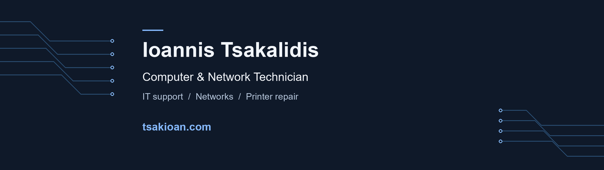

## Hi, I'm Ioannis 👋

I'm a computer and network technician in Larissa, Greece, working at CopyPrint E.E. with Xerox and Lexmark printers, IT support and networks.

Alongside my work, I'm studying for a BSc (Hons) in Computing (Artificial Intelligence) from the University of Essex, delivered at Aegean College.

### Portfolio & projects

- **[tsakioan.com](https://tsakioan.com/)** — My bilingual portfolio, printer test sheet and IPv4 subnet calculator. [Source code](https://github.com/MrTsak/tsakioan-portfolio)
- **[Diabetes Data Analysis](https://tsakioan.com/projects/diabetes/)** — An educational machine-learning project with interactive charts and model comparisons in English and Greek. [Source code](https://github.com/MrTsak/AI-Data-Analytics)

### Find me

[Portfolio](https://tsakioan.com/) · [LinkedIn](https://www.linkedin.com/in/tsak/) · [Email](mailto:info@tsakioan.com)
